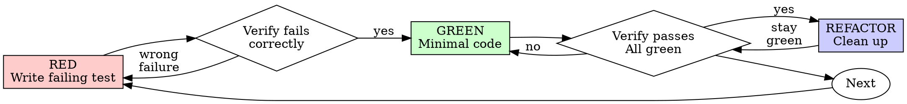

# Test-Driven Development (TDD)

## Overview

Write the test first. Watch it fail. Write minimal code to pass.

**Core principle:** If you didn't watch the test fail, you don't know if it tests the right thing.

**Violating the letter of the rules is violating the spirit of the rules.**

## When to Use

**Always:** new features · bug fixes · refactoring · behavior changes.

**Exceptions (ask your human partner):** throwaway prototypes · generated code · configuration files.

Thinking "skip TDD just this once"? Stop. That's rationalization.

## The Iron Law

```
NO PRODUCTION CODE WITHOUT A FAILING TEST FIRST
```

Write code before the test? Delete it. Start over.

**No exceptions:** don't keep it as "reference", don't "adapt" it while writing tests, don't look at it.
Delete means delete. Implement fresh from tests. Period.

## Red-Green-Refactor



### RED — Write Failing Test

One minimal test showing what should happen.

**Requirements:** one behavior · clear name · real code (no mocks unless unavoidable).

### Verify RED — Watch It Fail

**MANDATORY. Never skip.** Run the test and confirm:

- Test fails (not errors)
- Failure message is expected
- Fails because the feature is missing (not typos)

Test passes? You're testing existing behavior. Fix the test. Test errors? Fix the error and re-run
until it fails correctly.

### GREEN — Minimal Code

Write the simplest code to pass the test. Don't add features, refactor other code, or "improve"
beyond the test.

### Verify GREEN — Watch It Pass

**MANDATORY.** Confirm: test passes · other tests still pass · output pristine (no errors/warnings).

Test fails? Fix code, not test. Other tests fail? Fix now.

### REFACTOR — Clean Up

After green only: remove duplication · improve names · extract helpers. Keep tests green. Don't add
behavior.

### Repeat

Next failing test for next feature.

## Good Tests

| Quality | Good | Bad |
|---------|------|-----|
| **Minimal** | One thing. "and" in name? Split it. | `test('validates email and domain and whitespace')` |
| **Clear** | Name describes behavior | `test('test1')` |
| **Shows intent** | Demonstrates desired API | Obscures what code should do |

## Verification Checklist

Before marking work complete:

- [ ] Every new function/method has a test
- [ ] Watched each test fail before implementing
- [ ] Each test failed for expected reason (feature missing, not typo)
- [ ] Wrote minimal code to pass each test
- [ ] All tests pass
- [ ] Output pristine (no errors, warnings)
- [ ] Tests use real code (mocks only if unavoidable)
- [ ] Edge cases and errors covered

Can't check all boxes? You skipped TDD. Start over.

## Debugging Integration

Bug found? Write a failing test reproducing it. Follow the TDD cycle. Test proves the fix and prevents
regression. Never fix bugs without a test.

## References

Read only when needed — they are not part of the always-on core:

- [`references/examples.md`](references/examples.md) — Good/Bad RED/GREEN code and a full bug-fix
  walkthrough. Read when you need concrete code.
- [`references/rationalizations.md`](references/rationalizations.md) — why order matters, common
  rationalizations, red flags and what to do when stuck. Read when you feel the urge to skip TDD.
- [`testing-anti-patterns.md`](testing-anti-patterns.md) — when adding mocks or test utilities.

## Final Rule

```
Production code → test exists and failed first
Otherwise → not TDD
```

No exceptions without your human partner's permission.
