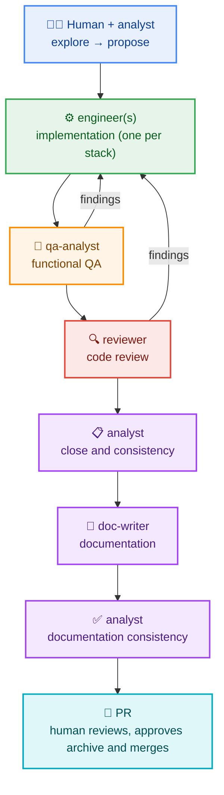

# 🧭 ATLAS — OpenSpec + Agents

**A template for AI-driven software development with SDD.**

[](../LICENSE)
[](harness/en/QUICKSTART.md)
[](../.atlas/BOOTSTRAP.md)
[](harness/en/COMPATIBILITY.md)
[](https://github.com/cedaniel200/atlas-template/releases)

> **ATLAS** (*Agnostic Template for LLM Agent Systems*) is a template for **AI-driven software
> development with SDD (Spec-Driven Development)**: the agent works from specifications, decisions
> and gates, not improvisation.
>
> It saves you from building from scratch the project contract, the OpenSpec schema, the agent roles,
> the skills, the stack profiles and the bootstrap ritual: use the template, answer a questionnaire
> and start building.
>
> It is **agnostic** of domain, architecture and host tool (OpenCode, Claude Code, Codex, Cursor), and
> **efficient by design**: bounded context, on-demand procedures and automated validations before
> every merge.
>
> **In practice:**
> - 🧭 **SDD**: first `proposal → specs → design → ADR → tasks`; then code.
> - ⚙️ **Gated roles**: analyst → **implementer(s)** (each stack generates its `engineer-<stack>`) → QA → reviewer → doc-writer.
> - 🧩 **Multi-stack and multi-host**: one profile per stack; the same harness in three tools.
>
> **Language:** English · [Español](README.md)
>
> **Glossary:** ATLAS is the product; “template” is used as a common noun.

---

## 🗺️ ATLAS flow



QA and reviewer findings go back to the corresponding implementer (global cap: **5 iterations**
between both). Each change is **1 reviewable PR** (≤ 800–1200 lines, 1–2 specs) and the human approves
each artifact. The archive is committed **inside the PR, before merge**; if the PR was already merged
without archive, open an archive PR.

**Support roles (optional, outside the delivery cycle):**

| Role | What it is for |
|---|---|
| `mentor` (optional) | Teach, agnostically, the concepts and patterns the project uses (DDD, architecture, design) according to its context and stack; explain the code and generate learning material |
| `business-strategist` (optional) | Business model, value proposition, segments, pricing and channels (`docs/business/`) |

> They are not part of the delivery cycle: they are added as project agents or packs.
> The bootstrap asks for them **one by one** (Round 4) and only installs the accepted ones in
> `state.optional_agents`.

---

## 🧵 Parallel runs (experimental)

[](../.atlas/docs/en/parallel-run.md)

> ⚗️ **Experimental.** It is not the default flow. It is enabled only when the user asks and confirms.

- **One large spec → N agents**: split the work into units with disjoint paths.
- **Several large specs → program**: each spec with its N agents, dependencies and frozen contracts.
- Requirements: globally disjoint paths, contract before backend/front and human confirmation.
- **Commits**: shared worktree → the orchestrator commits; `per-unit-worktree` → each agent in its branch.
- **Traceability**: one commit per handoff/checkpoint; in per-unit, merge/cherry-pick without squash.
- Protocol and validation: [`.atlas/docs/en/parallel-run.md`](../.atlas/docs/en/parallel-run.md) · `validar-run.mjs`.

---

## 🚀 Start here

### 1️⃣ Create the project from ATLAS

- **GitHub:** use **Use this template** (recommended).
- **Manual:** download or clone this repository and place its contents at the **project root**
  (where `AGENTS.md` will live).

### 2️⃣ Start the ritual

Open the project with your tool and say:

> **“Configure this project”**

The agent reads [`../AGENTS.md`](../AGENTS.md), sees `.atlas/state.json` is `pending` and runs
[`../.atlas/BOOTSTRAP.md`](../.atlas/BOOTSTRAP.md).

> The project `README.md` is generated from `.atlas/PROJECT-README.md`; this page is the ATLAS landing
> page (there is no root README by design).

### 3️⃣ What you can ask the agent

Once the ritual is done, ask in your own words; if the agent infers the action from intent, **it will
ask for explicit confirmation before acting**.

- Start or continue a change: “in this session we will work on X” / “continue X”.
- Run two independent specs in parallel (experimental): ask for confirmation and follow `parallel-run.md`.
- Add a stack or profile, an implementer or a pack.
- Add an implementer for a new technology: “add an implementer for React”.
- Minimize ATLAS (`minimizar.mjs`).
- Update ATLAS or measure context.

Detail: [`.atlas/docs/en/extending.md`](../.atlas/docs/en/extending.md).

### 4️⃣ Choose your guide

| If… | Go to |
|---|---|
| You are starting a **new** project | [`docs/harness/en/QUICKSTART.md`](harness/en/QUICKSTART.md) |
| You already have a project | [`docs/harness/en/ADOPTION.md`](harness/en/ADOPTION.md) |
| You want to update the harness | [`docs/harness/en/UPDATE.md`](harness/en/UPDATE.md) |
| You want to configure MCP or memory | [`docs/harness/en/TOOLS.md`](harness/en/TOOLS.md) |
| You care about gates and CRAP | [`docs/harness/en/QUALITY.md`](harness/en/QUALITY.md) |
| You want to understand the commit hooks | [`docs/harness/en/HOOKS.md`](harness/en/HOOKS.md) |
| You want to know where each change is written | [`docs/harness/en/ISOLATION.md`](harness/en/ISOLATION.md) |
| You do not understand a term | [`docs/harness/en/GLOSSARY.md`](harness/en/GLOSSARY.md) |
| Extend the harness (skills/agents/packs) | [`.atlas/docs/en/extending.md`](../.atlas/docs/en/extending.md) · [`.atlas/packs/README.md`](../.atlas/packs/README.md) |

---

## 📚 Documentation layers

| Layer | Where | For whom |
|---|---|---|
| 🏗️ **Internal harness** | [`.atlas/docs/en/`](../.atlas/docs/en/README.md) | People who maintain or extend ATLAS |
| 📘 **Usage** | [`docs/harness/en/`](harness/en/QUICKSTART.md) | People adopting ATLAS in their project |
| 📦 **Project** | `docs/architecture/`, `docs/api/`, `docs/functional/`, `docs/guides/` | The project team |
| 🧠 **Project context** | `docs/project-context.md` | The project team |

> The **project documentation** layers are optional: the ritual creates only the sections you choose
> and their root is `state.docs.root` (default `docs/`). The other layers do not depend on them.

---

## 📦 What it includes

| Component | Detail |
|---|---|
| 🧭 **OpenSpec** | Vendored `spec-driven-with-adr` schema (`proposal → specs → design → adr → tasks`) |
| 🤖 **Agents** | `analyst`, `engineer` (each stack generates `engineer-<stack>`), `reviewer`, `qa-analyst`, `doc-writer` in `.atlas/agents/`; optional: `mentor` and `business-strategist` (activated by the bootstrap) |
| 🧱 **Profiles** | Generated on demand with `crear-perfil.mjs` from `_templates/profile.yaml`; there is no catalog |
| 🎒 **Packs** | Skeletons with `crear-pack.mjs`; they exist only if the project needs them |
| 🧩 **Skills** | 17 portable core skills in `.agents/skills/` + optional packs in `.atlas/packs/` |
| 🚀 **Ritual** | [`../.atlas/BOOTSTRAP.md`](../.atlas/BOOTSTRAP.md): detects the tool, interviews the user and generates the context |
| 🧪 **Compatibility** | [`harness/en/COMPATIBILITY.md`](harness/en/COMPATIBILITY.md): per-host matrix |
| 🗂️ **State** | [`.atlas/`](../.atlas/README.md): hosts, profiles, packs, `state.stacks`, manifest and state |
| 🧠 **Project context** | [`docs/project-context.md`](project-context.md): project layer that complements `AGENTS.md` |

---

## 🗂️ Structure

```
.
├── AGENTS.md            # project contract
├── CLAUDE.md            # Claude Code stub
├── .agents/
│   └── skills/          # 17 portable core skills
├── .atlas/
│   ├── BOOTSTRAP.md     # first-session ritual
│   ├── PLACEHOLDERS.md  # placeholder contract (profile/project, N/A)
│   ├── PROJECT-README.md # project README template
│   ├── agents/          # 5 core prompts + 2 optional (+ generated engineer-<stack>)
│   ├── profiles/        # on-demand profiles (_templates/ + _examples/)
│   ├── packs/           # optional on-demand packs (_templates/ + active)
│   ├── docs/en|es/      # harness documentation (contributor)
│   ├── hosts/           # host adapter templates
│   ├── scripts/         # sha256 + validators + crear-perfil + crear-pack + mover-legal + minimizar + validar-run + adoptar-agents + combinar-readme + generar-manifiesto + inventariar + medir
│   ├── legal/           # template legal in configured projects
│   └── state.json (stacks, packs, optional_agents) manifest.json
├── docs/
│   ├── README.md        # Spanish landing page
│   ├── README.en.md     # this English landing page
│   ├── project-context.md # project-specific context
│   ├── harness/es|en/   # usage guides + COMPATIBILITY
│   ├── architecture/ api/ functional/ guides/   # project documentation
├── openspec/            # config, specs, changes, schemas
├── adr/
├── .githooks/           # git hooks (gitleaks)
├── SECURITY.md          # English security policy
├── SECURITY.es.md       # Spanish security policy
├── THIRD-PARTY-NOTICES.md # English third-party notices
├── THIRD-PARTY-NOTICES.es.md # Spanish third-party notices
└── LICENSE              # MIT (official English text)
```

---

## ✅ Requirements

- ✅ **Git**
- ✅ **Node.js** + **OpenSpec CLI** (`npm i -g @fission-ai/openspec`)
- ✅ **POSIX shell** (`sh`, `grep`, `diff`). On **Windows**: Git Bash or WSL (not `cmd.exe`)
- ➕ Optional: Docker, MCP (`Context7`), persistent memory (`Engram`)

---

## 🔒 Security, confidentiality and license

- 🔒 The repository **contains no credentials or business data**.
- ⚠️ Optional integrations may send data out of the repository: configuration and compliance are your
  responsibility.
- 📄 Software delivered **“AS IS”**, without warranty. See [`../SECURITY.md`](../SECURITY.md),
  [`../LICENSE`](../LICENSE) and [`../THIRD-PARTY-NOTICES.md`](../THIRD-PARTY-NOTICES.md).
- 🗂️ In the template repo, legal files live at the root because GitHub recognizes them; when configuring
  a project, the ritual moves them to `.atlas/legal/` and leaves the root free for the project's legal files.
