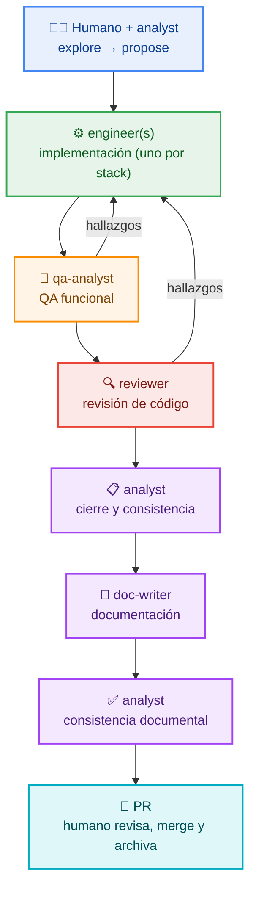

# 🧭 ATLAS — OpenSpec + Agentes

**Plantilla para desarrollo de software impulsado por IA con SDD.**

[](../LICENSE)
[](harness/es/QUICKSTART.md)
[](../.atlas/BOOTSTRAP.md)
[](harness/es/COMPATIBILITY.md)

> **ATLAS** (*Agnostic Template for LLM Agent Systems*) es una plantilla para **desarrollo de software
> impulsado por IA con SDD (Spec-Driven Development)**: el agente trabaja sobre especificaciones,
> decisiones y gates, no sobre improvisación.
>
> Te ahorra montar desde cero el contrato del proyecto, el esquema de OpenSpec, los roles de agente,
> las skills, los perfiles de stack y el ritual de arranque: usas la plantilla, respondes un
> cuestionario y empiezas a construir.
>
> Es **agnóstica** de dominio, arquitectura y herramienta anfitriona (OpenCode, Claude Code, Codex), y
> **eficiente por diseño**: contexto acotado, procedimientos bajo demanda y validaciones automáticas
> antes de cada merge.
>
> **En la práctica:**
> - 🧭 **SDD**: primero `proposal → specs → design → ADR → tasks`; después código.
> - ⚙️ **Roles con gates**: analyst → **implementador(es)** (cada stack genera su `engineer-<stack>`) → QA → reviewer → doc-writer.
> - 🧩 **Multi-stack y multi-host**: un perfil por stack; el mismo arnés en tres herramientas.
>
> **Idioma:** Español · [English](README.en.md)
>
> **Glosario:** ATLAS es el producto; “template/plantilla” se usa como sustantivo común.

---

## 🗺️ Flujo de ATLAS



Las correcciones de QA y reviewer vuelven al implementador correspondiente (tope global: **5 iteraciones** entre ambos).
Cada cambio es **1 PR revisable** (≤ 800–1200 líneas, 1–2 specs) y el humano aprueba cada artefacto.

**Roles de soporte (opcionales, fuera del ciclo de entrega):**

| Rol | Para qué sirve |
|---|---|
| `mentor` (opcional) | Enseñar, de forma agnóstica, los conceptos y patrones que use el proyecto (DDD, arquitectura, diseño) según su contexto y stack; explicar el código y generar material didáctico |
| `business-strategist` (opcional) | Modelo de negocio, propuesta de valor, segmentos, pricing y canales (`docs/business/`) |

> No forman parte del ciclo de entrega: se añaden como agentes o packs propios del proyecto.
> El bootstrap los pregunta **uno por uno** (Ronda 4) y solo instala los aceptados en
> `state.optional_agents`.

---

## 🧵 Ejecución paralela (experimental)

[](../.atlas/docs/es/parallel-run.md)

> ⚗️ **Experimental.** No es el flujo por defecto. Se activa solo si el usuario lo pide y confirma.

- **1 spec grande → N agentes**: divide el trabajo en unidades con rutas disjuntas.
- **Varias specs grandes → programa**: cada spec con sus N agentes, dependencias y contratos congelados.
- Requisitos: rutas globalmente disjuntas, contrato antes de backend/front y confirmación humana.
- **Commits**: worktree compartido → commitea el orquestador; `per-unit-worktree` → cada agente en su rama.
- **Trazabilidad**: un commit por handoff/checkpoint; en per-unit, merge/cherry-pick sin squash.
- Protocolo y validación: [`.atlas/docs/es/parallel-run.md`](../.atlas/docs/es/parallel-run.md) · `validar-run.mjs`.

---

## 🚀 Empieza aquí

### 1️⃣ Crea el proyecto desde ATLAS

- **GitHub:** usa **Use this template** (recomendado).
- **Manual:** descarga o clona este repositorio y coloca su contenido en la **raíz del proyecto**
  (donde vivirá `AGENTS.md`).

### 2️⃣ Arranca el ritual

Abre el proyecto con tu herramienta y di:

> **“Configura este proyecto”**

El agente lee [`../AGENTS.md`](../AGENTS.md), ve que `.atlas/state.json` está `pending` y ejecuta
[`../.atlas/BOOTSTRAP.md`](../.atlas/BOOTSTRAP.md).

> El `README.md` del proyecto se genera desde `.atlas/PROJECT-README.md`; este `docs/README.md` es la portada de ATLAS (no hay README raíz por decisión).

### 3️⃣ Lo que puedes pedir al agente

Cuando termine el ritual, pídeselo con tus palabras; si el agente deduce la acción de la intención,
**te pedirá confirmación antes de actuar**.

- Empezar o retomar un cambio: “en esta sesión trabajaremos X” / “retomemos X”.
- Ejecutar dos specs independientes en paralelo (experimental): pide confirmación y sigue `parallel-run.md`.
- Añadir un stack o perfil, un implementador o un pack.
- Añadir un implementador para una tecnología nueva: “añade un implementador para React”.
- Dejar ATLAS mínimo (`minimizar.mjs`).
- Actualizar ATLAS o medir el contexto.

Detalle: [`.atlas/docs/es/extending.md`](../.atlas/docs/es/extending.md).

### 4️⃣ Elige tu guía

| Si… | Ve a |
|---|---|
| Empiezas un proyecto **nuevo** | [`docs/harness/es/QUICKSTART.md`](harness/es/QUICKSTART.md) |
| Ya tienes un proyecto | [`docs/harness/es/ADOPTION.md`](harness/es/ADOPTION.md) |
| Quieres actualizar el arnés | [`docs/harness/es/UPDATE.md`](harness/es/UPDATE.md) |
| Quieres configurar MCP o memoria | [`docs/harness/es/TOOLS.md`](harness/es/TOOLS.md) |
| Te interesan los gates y CRAP | [`docs/harness/es/QUALITY.md`](harness/es/QUALITY.md) |
| No entiendes un término | [`docs/harness/es/GLOSSARY.md`](harness/es/GLOSSARY.md) |
| Extender el arnés (skills/agentes/packs) | [`.atlas/docs/es/extending.md`](../.atlas/docs/es/extending.md) · [`.atlas/packs/README.md` (EN)](../.atlas/packs/README.md) |

---

## 📚 Capas de documentación

| Capa | Dónde | Para quién |
|---|---|---|
| 🏗️ **Arnés interno** | [`.atlas/docs/es/`](../.atlas/docs/es/README.md) | Quien mantiene o extiende ATLAS |
| 📘 **Uso** | [`docs/harness/es/`](harness/es/QUICKSTART.md) | Quien adopta ATLAS en su proyecto |
| 📦 **Proyecto** | `docs/architecture/`, `docs/api/`, `docs/functional/`, `docs/guides/` | El equipo del proyecto |
| 🧠 **Contexto del proyecto** | `docs/project-context.md` | El equipo del proyecto |

---

## 📦 Qué incluye

| Componente | Detalle |
|---|---|
| 🧭 **OpenSpec** | Schema `spec-driven-with-adr` vendorizado (`proposal → specs → design → adr → tasks`) |
| 🤖 **Agentes** | `analyst`, `engineer` (cada stack genera `engineer-<stack>`), `reviewer`, `qa-analyst`, `doc-writer` en `.atlas/agents/`; opcionales: `mentor` y `business-strategist` (los activa el bootstrap) |
| 🧱 **Perfiles** | Se generan bajo demanda con `crear-perfil.mjs` desde `_templates/profile.yaml`; no hay catálogo |
| 🎒 **Packs** | Esqueletos con `crear-pack.mjs`; solo existen si el proyecto los necesita |
| 🧩 **Skills** | 17 skills core portables en `.agents/skills/` + packs opcionales en `.atlas/packs/` |
| 🚀 **Ritual** | [`../.atlas/BOOTSTRAP.md`](../.atlas/BOOTSTRAP.md): detecta la herramienta, interroga y genera el contexto |
| 🧪 **Compatibilidad** | [`harness/es/COMPATIBILITY.md`](harness/es/COMPATIBILITY.md): matriz por host |
| 🗂️ **Estado** | [`.atlas/`](../.atlas/README.md): hosts, perfiles, packs, `state.stacks`, manifiesto y estado |
| 🧠 **Contexto del proyecto** | [`docs/project-context.md`](project-context.md): capa propia que complementa `AGENTS.md` |

---

## 🗂️ Estructura

```
.
├── AGENTS.md            # contrato del proyecto
├── CLAUDE.md            # stub para Claude Code
├── .agents/
│   └── skills/          # 17 skills core portables
├── .atlas/
│   ├── BOOTSTRAP.md     # ritual de primera sesión
│   ├── PLACEHOLDERS.md  # contrato de placeholders (perfil/proyecto, N/A)
│   ├── PROJECT-README.md # plantilla del README del proyecto
│   ├── agents/          # 5 prompts core + 2 opcionales (+ engineer-<stack> generado)
│   ├── profiles/        # perfiles bajo demanda (_templates/ + _examples/)
│   ├── packs/           # packs opcionales bajo demanda (_templates/ + activos)
│   ├── docs/en|es/      # documentación del arnés (contribuidor)
│   ├── hosts/           # plantillas de adaptador por host
│   ├── scripts/         # sha256 + validadores + crear-perfil + crear-pack + mover-legal + minimizar + validar-run + adoptar-agents + combinar-readme + generar-manifiesto + inventariar + medir
│   ├── legal/           # legal del template en proyectos configurados
│   └── state.json (stacks, packs, optional_agents) manifest.json
├── docs/
│   ├── README.md        # este índice (portada de ATLAS)
│   ├── README.en.md     # portada en inglés
│   ├── project-context.md # contexto propio del proyecto
│   ├── harness/es|en/   # guías de uso + COMPATIBILITY
│   ├── architecture/ api/ functional/ guides/   # documentación del proyecto
├── openspec/            # config, specs, changes, schemas
├── adr/
├── .githooks/           # hooks de git (gitleaks)
├── SECURITY.md          # política de seguridad (EN)
├── SECURITY.es.md       # política de seguridad (ES)
├── THIRD-PARTY-NOTICES.md    # avisos de terceros (EN)
├── THIRD-PARTY-NOTICES.es.md # avisos de terceros (ES)
└── LICENSE              # MIT (texto oficial en inglés)
```

---

## ✅ Requisitos

- ✅ **Git**
- ✅ **Node.js** + **OpenSpec CLI** (`npm i -g @fission-ai/openspec`)
- ✅ **Shell POSIX** (`sh`, `grep`, `diff`). En **Windows**: Git Bash o WSL (no `cmd.exe`)
- ➕ Opcional: Docker, MCP (`Context7`), memoria persistente (`Engram`)

---

## 🔒 Seguridad, confidencialidad y licencia

- 🔒 El repositorio **no incluye credenciales ni datos de negocio**.
- ⚠️ Las integraciones opcionales pueden sacar datos del repo: la configuración y el cumplimiento son
  responsabilidad del usuario.
- 📄 Software entregado **“AS IS”**, sin garantía. Ver [`../SECURITY.es.md`](../SECURITY.es.md),
  [`../LICENSE`](../LICENSE) y [`../THIRD-PARTY-NOTICES.es.md`](../THIRD-PARTY-NOTICES.es.md).
- 🗂️ En el repo del template, el legal vive en la raíz porque GitHub lo reconoce; al configurar un
  proyecto, el ritual lo mueve a `.atlas/legal/` y deja la raíz libre para el legal del proyecto.
